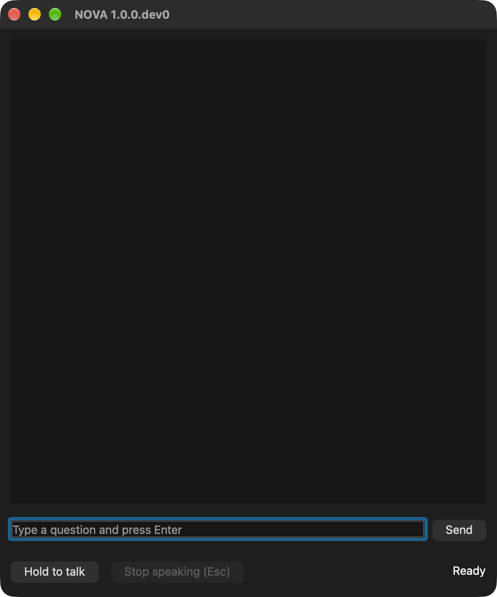

# NOVA

[](https://github.com/mesubash/nova/actions/workflows/ci.yml)

A macOS-first personal AI voice assistant, built as a learning project on a MacBook Air M4.

**Status:** V1.0. A personal voice assistant for macOS with typed and spoken conversation, a desktop window, confirmed desktop actions, and persistent notes. Built as a learning project; see [docs/PLAN.md](docs/PLAN.md) and [docs/architecture.md](docs/architecture.md).



## What works now

- Typed chat in the terminal with follow-up context (the last N exchanges are remembered).
- Clear messages for missing configuration, timeouts, network failures and API errors.
- Automatic retry (up to 3 attempts) when Gemini's servers are temporarily overloaded.
- `/exit`, Ctrl+D or Ctrl+C to quit; Ctrl+C while waiting cancels only that question.
- Answers are spoken aloud with macOS `say` while the text stays visible.
- Press Enter or type `/stop` to stop speaking.
- Press Enter on an empty line to ask by voice; press Enter again to stop recording.
- Recordings stop automatically after `NOVA_MAX_RECORDING_SECONDS`; silence is detected without calling the API.
- Desktop window (`nova-gui`) with transcript, hold-to-talk, stop speaking (Esc), and visible status; it stays responsive during requests.

## Performance

Measured on 2026-11-13 with `scripts/measure_latency.py` on a MacBook Air M4 over home Wi-Fi in Nepal, using `gemini-3.5-flash-lite` (8 runs; 1 further run hit the free-tier rate limit):

| Step | Median | Fastest | Slowest |
| --- | --- | --- | --- |
| Transcription | 2.27 s | 1.56 s | 2.55 s |
| Model reply | 1.21 s | 0.93 s | 2.13 s |
| Speech start | 0.01 s | 0.00 s | 0.01 s |
| **Total: release Talk → speech starts** | **3.40 s** | 2.70 s | 4.35 s |

"Speech start" is when the `say` process is launched, not when sound is first heard. Network conditions and Gemini's load change these numbers; rerun the script to measure your own setup. The packaged app is 134 MB, mostly the Qt framework.

## Limitations

- macOS on Apple Silicon only; tested on a MacBook Air M4.
- Requires an internet connection: chat and transcription both use Gemini.
- Gemini's free tier allows 15 requests per minute for this model. A voice question uses two (transcribe, then answer); beyond the limit NOVA shows a rate-limit error.
- Push-to-talk only: no wake word, and you cannot interrupt NOVA by speaking.
- One action per request. Action results and notes are not sent back to the model, so it cannot reason about them (for example, which file is newest).
- Note search matches keywords, not meaning.
- The API key is stored in a private file rather than the macOS Keychain.
- The app is not signed with a Developer ID or notarized.

## Requirements

- macOS. Tested on a MacBook Air M4 with macOS 27.2.1.
- Python 3.12
- A Gemini API key from [Google AI Studio](https://aistudio.google.com/)

## Setup

```bash
git clone https://github.com/mesubash/nova.git
cd nova
python3.12 -m venv .venv
source .venv/bin/activate
pip install -r requirements.lock
pip install -e . --no-deps
cp .env.example .env
```

Then open `.env` and set `GEMINI_API_KEY` and `GEMINI_MODEL`.

## Configuration

| Variable | Required | Default | Meaning |
| --- | --- | --- | --- |
| `GEMINI_API_KEY` | Yes | | Your Gemini API key |
| `GEMINI_MODEL` | Yes | | Model ID, for example `gemini-3.5-flash-lite` |
| `NOVA_REQUEST_TIMEOUT` | No | `30` | Seconds to wait for each request |
| `NOVA_MAX_HISTORY_TURNS` | No | `10` | Exchanges kept as conversation context |

## Run

```bash
nova
```

`python -m nova` also works.

For the desktop window:

```bash
nova-gui
```

## Build the macOS app

```bash
pip install -e ".[build]"
scripts/build_app.sh
open dist/NOVA.app
```

The app reads its settings from `~/Library/Application Support/NOVA/config.env`; on first launch without settings it offers to create and open that file.

The build is for Apple Silicon and is **not signed with a Developer ID or notarized**. An app you build yourself opens normally. If you download it instead, macOS will warn you: right-click the app and choose Open, or allow it in System Settings › Privacy & Security. macOS may ask for microphone access again after each rebuild.

## Development

GitHub Actions runs the same checks on every push and pull request (macOS, Python 3.12). See [docs/architecture.md](docs/architecture.md) for how the modules fit together.

```bash
pytest
ruff format --check .
ruff check .
```

The tests use fake clients and never call the real API. To measure real model latency on your machine (this makes billable API calls):

```bash
python scripts/benchmark_models.py
```

## Privacy

Everything you type, plus the current session's conversation history, is sent to Google's Gemini API. NOVA does not save conversations to disk. On Gemini's free tier, Google may use prompts to improve its products; check the current [Gemini API terms](https://ai.google.dev/gemini-api/terms) before sending anything private.

## Project layout

```text
src/nova/
├── __main__.py      # entry point and chat loop
├── config.py        # configuration loading and validation
├── ai.py            # the only module that talks to Gemini
└── conversation.py  # bounded session history
docs/
├── PLAN.md          # milestones and completion criteria
└── decisions.md     # why things are built the way they are
```

## License

MIT