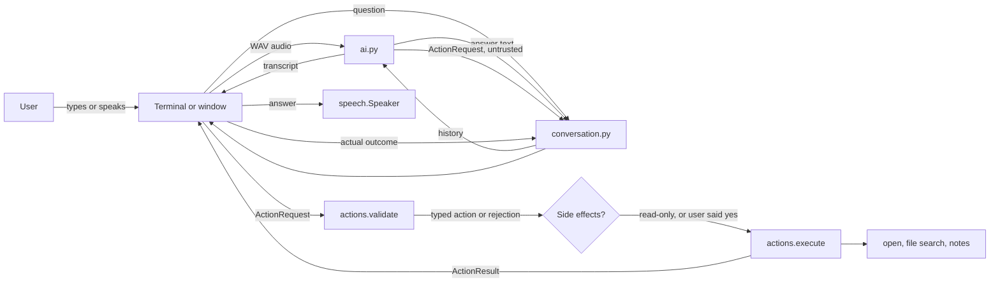

# Architecture

NOVA is a single Python package with a terminal interface (`nova`) and a desktop window (`nova-gui`). Both use the same core modules; the interfaces only handle input, output, and threading.

## Modules

| Module | Responsibility | Talks to |
| --- | --- | --- |
| `config.py` | Load and validate settings once at start-up | Environment, `.env` |
| `ai.py` | The only module that calls Gemini: chat, transcription, action proposals, retries | Gemini API |
| `conversation.py` | Bounded session history; records actions only after their outcome | A `Responder` (any object with `reply()`) |
| `speech.py` | Background speech with `say`; microphone recording with `sounddevice` | macOS `say`, microphone |
| `actions/` | Validate untrusted proposals, confirm, execute, report outcomes | `open`, filesystem, notes |
| `storage.py` | SQLite notes with stable IDs and transactions | `notes.db` in Application Support |
| `__main__.py` | Terminal loop | Everything above |
| `ui/` | PySide6 window and the background `TaskRunner` | Everything above |

## Request flow

## Trust boundary

Model output is untrusted input. Gemini can only *propose* one of eight declared actions. `validate()` checks the action name, the exact set of arguments, their types and lengths, the app allowlist, URL schemes, and note IDs, and returns a typed action object or raises `ActionRejected`. `execute()` accepts only those typed objects, so raw model output cannot reach `subprocess`, the filesystem, or the database.

Actions with side effects (opening apps or URLs, saving, editing, deleting notes) always ask first, defaulting to No. Action results, file names, and stored notes are never sent back to Gemini, which also removes a prompt-injection path.

## Threading

- **Terminal:** single-threaded, except `sounddevice`'s audio callback thread, which only appends audio chunks.
- **Window:** the Qt UI thread owns all widgets. `TaskRunner` runs one blocking task at a time (recording, transcription, Gemini requests, action execution) on a single worker thread and returns results through queued Qt signals. Cancelling advances a task number so late results are dropped.
- **Speech:** `say` runs as a separate process; the window polls it with a `QTimer`.
- **Notes:** each database operation opens its own SQLite connection, so it is safe from either thread.

## Data and privacy

| Data | Where it lives | Sent to Gemini? |
| --- | --- | --- |
| Typed questions and session history | Memory, cleared on exit | Yes |
| Voice recordings | Memory only, never written to disk | Yes, for transcription |
| Action results and file names | Shown on screen | No |
| Saved notes | `~/Library/Application Support/NOVA/notes.db` (mode 600) | No, except the text you say while saving or editing |
| API key | `.env` (development), never logged | Used only to authenticate |

## Errors

Each layer raises its own error type with a message that is safe to show: `ConfigError`, `AIError` (with a `retryable` flag), `RecordingError`, `SpeechError`, `ActionRejected`, and `StorageError`. The interfaces turn these into visible messages and return to a usable state. Any other exception is treated as a bug and labelled as unexpected rather than hidden.

## Testing

Every external dependency is a parameter that tests replace with a fake: the Gemini client, `sleep`, `subprocess.Popen` and `subprocess.run`, the audio stream, the stop-recording wait, and the clock. SQLite and file search run against real files in temporary folders. The window is tested with pytest-qt, rendered off-screen. Tests never call the real API; `scripts/benchmark_models.py` makes live calls explicitly and separately.
